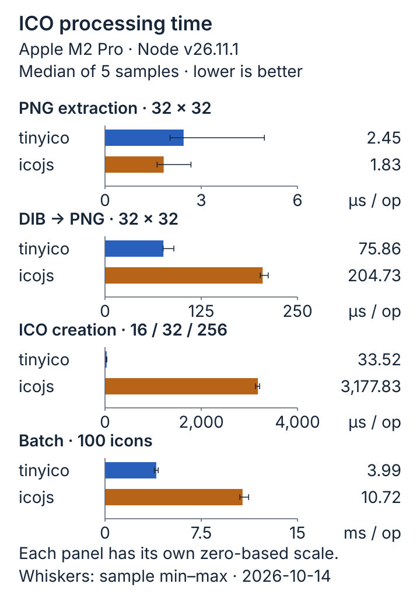
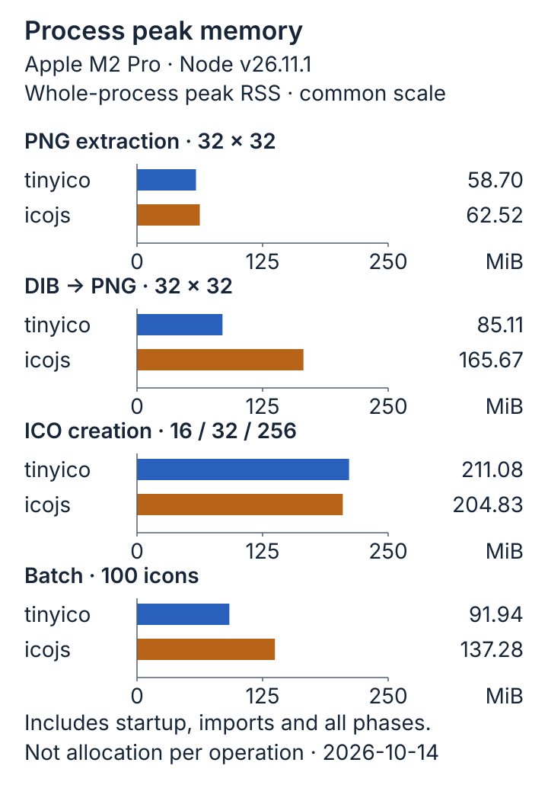

# Local benchmark and package measurements

Measured 2026-10-14T18:29:00.454Z on Apple M2 Pro, darwin/arm64, Node.js v26.11.1.
tinyico 0.1.0; icojs 1.0.1, installed outside the repository.

This is a deterministic synthetic fixture corpus, not a representative survey
of real-world favicons. Results describe this local run only. Raw samples,
fixture SHA-256 hashes, memory snapshots and environment metadata are in
[bench/results.json](./bench/results.json).

## Timing

Five samples per case, median reported. Each library/case runs in a fresh
process with warmup. Assertions and fixture generation are excluded.



The chart uses a separate zero-based scale for each operation; compare the
libraries within a panel. Batch values are milliseconds per 100-icon operation;
the other panels use microseconds. Whiskers show observed sample min–max,
not confidence intervals. The metadata-only and no-op cases remain in the
table because they have no equivalent operation or are timing baselines.

| Operation   | Library | Iterations/sample | Median ms/sample | Microseconds/op |    Ops/s |
| ----------- | ------- | ----------------: | ---------------: | --------------: | -------: |
| metadata    | tinyico |               500 |            1.372 |           2.743 |   364509 |
| png-extract | tinyico |               500 |            1.225 |           2.450 |   408108 |
| png-extract | icojs   |               500 |            0.915 |           1.830 |   546523 |
| dib-to-png  | tinyico |               500 |           37.928 |          75.856 |    13183 |
| dib-to-png  | icojs   |               500 |          102.366 |         204.731 |     4884 |
| encode      | tinyico |               500 |           16.758 |          33.517 |    29836 |
| encode      | icojs   |               500 |         1588.917 |        3177.834 |      315 |
| batch       | tinyico |                 5 |           19.972 |        3994.358 |      250 |
| batch       | icojs   |                 5 |           53.589 |       10717.825 |       93 |
| overhead    | tinyico |               500 |            0.009 |           0.017 | 57696746 |
| overhead    | icojs   |               500 |            0.065 |           0.129 |  7736944 |

Metadata reads mixed.ico (16px PNG, rectangular 4-bit DIB, 256px PNG).
PNG extraction uses png.ico (one 32px PNG). DIB conversion uses legacy.ico
(one 32px 32-bit DIB with meaningful alpha). ICO encoding uses identical
16/32/256 PNG inputs; icojs receives usePngIcon: true. One batch operation
decodes 100 icons sequentially, alternating PNG and DIB. Multiply batch ops/s
by 100 for icons/s.

On this corpus icojs was faster at PNG extraction. tinyico was faster at DIB
conversion and PNG-container creation. The extraction validation differs:
tinyico verifies chunk CRCs; icojs's PNG path copies bytes without that check.
PNG encoding also differs: icojs decodes PNG pixels to discover dimensions,
while tinyico reads IHDR and validates chunks without pixel decoding.
DIB compression filters/output sizes differ. These are whole API timings,
not isolated measurements of equivalent internal algorithms.

icojs has no public metadata-only equivalent, so no substitute full-decode
comparison or speed ratio is reported. Sync and async no-op rows quantify
loop/await overhead without subtracting it. The synchronous no-op can be
optimized heavily by V8 and is not a standalone estimate of library overhead.
The sub-millisecond baselines and short PNG samples are particularly noisy.

## Memory

Separate untimed experiment, 16 operation results retained after repeated GC.
Deltas compare retained state to the post-timing baseline. Negative/small heap
deltas reflect GC/JIT noise. RSS is the process high-water mark, including
startup, fixtures, imports, warmup, timed loops and the memory phase. It is
not a transient-allocation measurement or proof of leak freedom.



| Operation   | Library | Retained heap delta KiB | External delta KiB | ArrayBuffer delta KiB | Process peak RSS MiB |
| ----------- | ------- | ----------------------: | -----------------: | --------------------: | -------------------: |
| metadata    | tinyico |                     8.3 |                0.0 |                   0.0 |                 59.1 |
| png-extract | tinyico |                    -2.1 |                0.0 |                   0.0 |                 58.7 |
| png-extract | icojs   |                     2.4 |               61.5 |                  61.4 |                 62.5 |
| dib-to-png  | tinyico |                     3.7 |              512.5 |                 512.5 |                 85.1 |
| dib-to-png  | icojs   |                    -4.4 |               24.4 |                  24.4 |                165.7 |
| encode      | tinyico |                     4.0 |             3909.1 |                3909.0 |                211.1 |
| encode      | icojs   |                   -13.0 |             3909.1 |                3909.0 |                204.8 |
| batch       | tinyico |                   515.8 |            25625.0 |               25625.0 |                 91.9 |
| batch       | icojs   |                   686.8 |             7489.9 |                7489.8 |                137.3 |

ArrayBuffer bytes are included in external; do not sum these columns.
PNG passthrough aliases source memory in tinyico, while the comparator copies
its output. For batch decoding, result shapes and retained intermediate
pixel data differ, so retained memory is not an equal-shaped object comparison.
Raw before/retained/after-release snapshots are available in the JSON report.

## Reproduce

```sh
npm ci
npm install --prefix /tmp/tinyico-icojs-bench --no-audit --no-fund --save-exact icojs@1.0.1
TINYICO_ICOJS_ROOT=/tmp/tinyico-icojs-bench npm run bench -- --json=/tmp/tinyico-results.json
```

The default is 500 operations per sample (5 batches of 100 icons). Set
TINYICO_BENCH_ITERATIONS for longer runs. A plain npm run bench also works
without icojs and labels the comparator unavailable. No package is downloaded
automatically. See the README for interpretation and implementation limits.

Regenerate the four SVG documentation assets with `npm run docs:graphics`.
The generator uses the saved measurements, checks each chart median against
the original samples and requires both libraries' comparison rows. It adds no
dependencies. Assets live in `docs/assets/` and stay outside the npm tarball.

## Package footprint

- dist/: **26,103 bytes** of file contents across 16 files.
- Compiled JavaScript: **21,031 bytes** (eight ESM modules).
- Declarations: **5,072 bytes** (eight .d.ts files).
- npm pack --dry-run: **14,757 bytes compressed**, **44,900 bytes unpacked**, **19 files**.
- Included: dist/_.js, dist/_.d.ts, README.md, LICENSE, package.json.
- Excluded: src/, test/, fixtures, bench/, docs/, this report, development dependencies.
- Runtime dependencies: **0**. Optional dependencies: **0**. No bundled dependencies.

Footprint includes documentation. Filesystem block usage (for example du -sk)
can be higher than the sum of file contents. Tarball size changes with metadata
or documentation edits; these numbers describe the verified 0.1.0 artifact.

## Validation record

- npm install, typecheck and TypeScript build completed on Node.js 26.11.1.
- 90 native node:test tests passed, including exact pixel/alpha roundtrips and
  2,000 deterministic mutation cases.
- 37 additional independent pngjs pixel/layout/color-format checks passed,
  using only the isolated comparator installation.
- The packed tarball was installed in a separate consumer with no other
  runtime packages; ESM execution, exact RGBA/alpha checks and public
  TypeScript declaration consumption passed.
- npm ls --omit=dev --all reported no runtime dependencies. The manifest has
  neither dependencies nor optionalDependencies.
- npm pack --dry-run and npm run release:dry completed successfully. The
  latter ran prepublishOnly (typecheck, 90 tests, build) and did not publish.
- The dry-run registry metadata lookup encountered DNS ENOTFOUND. Package
  name availability and account ownership were not verified; check them
  with npm view/npm whoami before a real release.
- The benchmark also ran successfully without icojs; that mode downloads
  nothing and reports the absent comparator.
